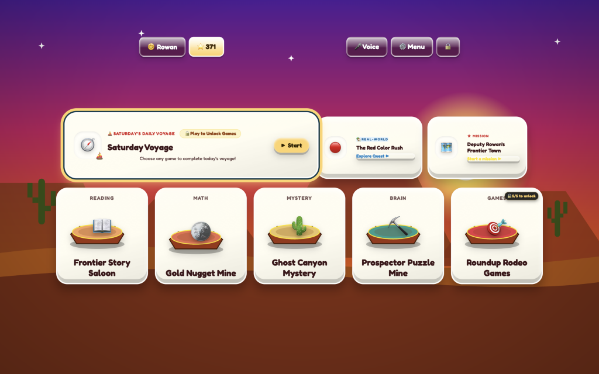
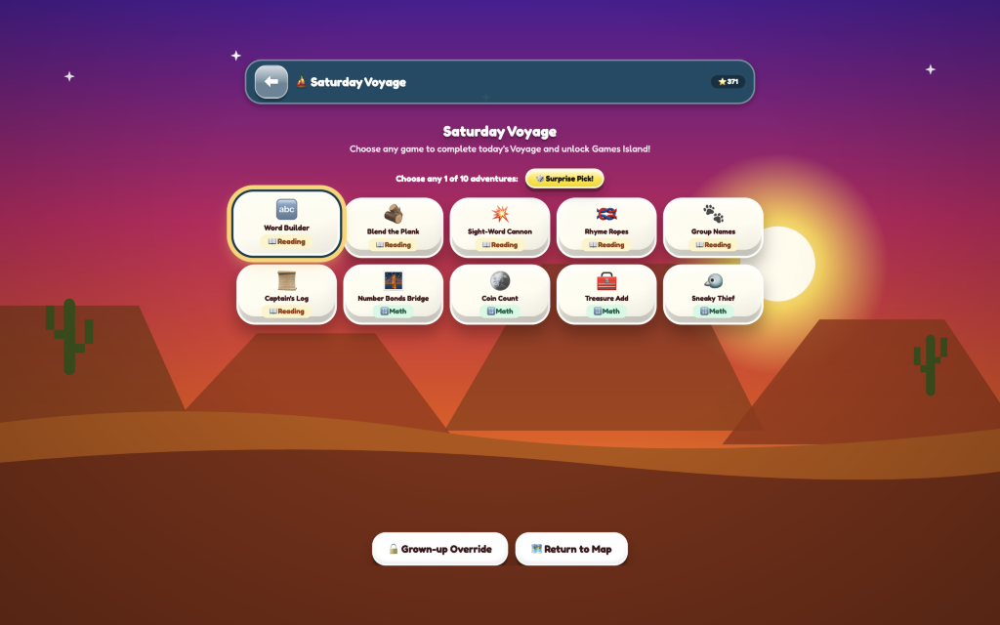
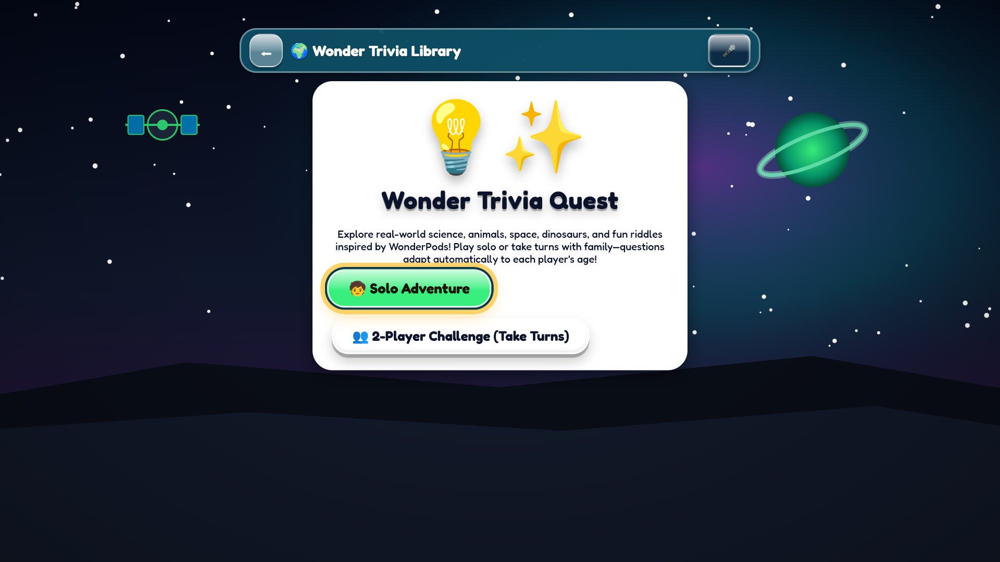
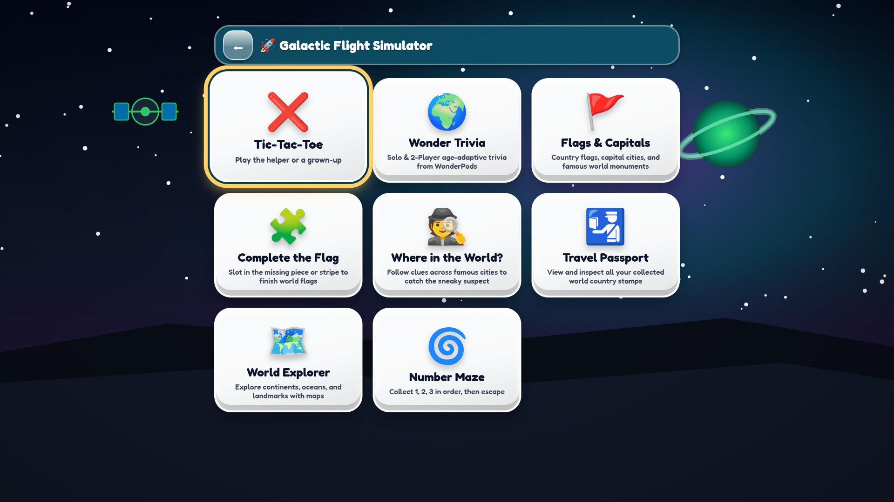
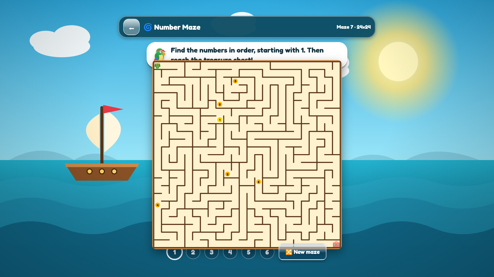

# Rowan's Learning World

A private, offline-first learning adventure designed for a 5-year-old child: phonics and arithmetic at the core, high-interest exploration and gamification on top.

Runs seamlessly on **Android TV** (via remote control D-pad), **Tablets**, and **Desktop/Mobile browsers** from a single unified TypeScript codebase.

* **Live Hosted Web App:** [https://rowan-learning-world-ap1.web.app](https://rowan-learning-world-ap1.web.app)
* **Android TV APK:** Built in `android-tv/` with offline asset bundling.

---

## Visual Showcase

### 1. Hub Map & Daily Voyage Hero Card
The main command center displays the child's daily routine, active companion, star bank, real-world quest, and islands.


### 2. Daily Voyage Selection (5×2 Curriculum Grid)
On weekend Free Choice days, the child can choose any of the 10 reading or math activities, or tap "Surprise Pick!".


### 3. World Explorer & Geography Island
Interactive SVG maps, continent exploration, and country trivia.


### 4. Geography & Flag Trivia
Real-world flag identification with visual aids, facts, and hints.


### 5. Number Maze Navigation
Spatial reasoning and number-order maze pathfinding designed for TV D-pad and touch.


---

## Core Systems & Learning Architecture

### 1. Daily Voyage & The "Effort Over Perfection" Engine
Kids focus best in short 10–15 minute daily rounds. The Daily Voyage gates arcade games behind educational practice:
* **Structured Weekdays (Monday–Thursday)**:
  * **Monday**: Word Builder *(Reading)* & Coin Count *(Math)*
  * **Tuesday**: Rhyme Ropes *(Reading)* & Number Bonds Bridge *(Math)*
  * **Wednesday**: Blend the Plank *(Reading)* & Treasure Add *(Math)*
  * **Thursday**: Sight-Word Cannon *(Reading)* & Sneaky Thief *(Math)*
* **Unstructured Weekends (Friday, Saturday & Sunday)**:
  * Zero forced routine. Free choice across all 10 curriculum apps in a clean 5×2 grid.
  * **🎲 Surprise Pick!**: Generates a mystery challenge for the child.
* **Effort Over Perfection (Grit Stars)**:
  * Scoring 5/5 on the first attempt awards **+5 Bonus Stars** and confetti.
  * If a mistake is made, the child is never locked out. A single tap on **`🔁 Try Again (+2 Grit Stars! ⭐)`** gives fresh questions from the same skill—rewarding resilience and perseverance rather than penalizing mistakes. Completing the retry unlocks Games Island.
* **Track Nudging**: If a child repeatedly chooses the same subject, the companion gently nudges: *"💡 You've been a Math Master! Ready to show your super Reading powers today?"*
* **Parent Override**: Accessible from both the Voyage screen and locked island modals.

### 2. Physical Real-World Missions (71 Screen-Free Quests)
A dedicated `🏡 Real-World Mission` card on the Hub map prompts the child to explore their physical home:
* **Phonics**: Sound hunts for beginning sounds (/b/, /s/, /m/, /t/, /c/, /p/, /f/, etc.), digraphs (/sh/, /ch/, /th/, /wh/), and blends (/st/, /sp/, /cl/, /gr/, /fl/).
* **Rhymes & Endings**: Rhyme hunts (cat/hat, frog/dog, star/car) and ending consonants.
* **Real-World Math**: Counting pairs of socks by twos (2, 4, 6), counting hallway doors, spotting clock digits, dividing 10 crayons into 5 and 5, counting window panes.
* **Shapes & Textures**: Searching for triangle coat hangers, oval spoons, cylinders, rough vs. smooth textures, and cold vs. warm tactile exploration.
* **Family & World Connections**: Clapping family name syllables, kitchen spice safari (cinnamon & cardamom), airplane packing, asking parents about childhood games, and kindness high-fives.
* Complete with speech narration, celebratory confetti, and +2 real-world star rewards.

### 3. Curriculum Mini-Apps & Games
* **Reading & Phonics**:
  * **Word Builder**: Tap or drag letter tiles to spell target phonics patterns.
  * **Blend the Plank**: Sound out phonetic wooden planks.
  * **Sight-Word Cannon**: Visual targeting and reading of high-frequency words.
  * **Rhyme Ropes**: Swing across matching rhymes.
  * **Group Names**: Animal packs, collective nouns (pride of lions, pod of whales), and irregular plurals.
  * **Captain's Log**: Following multi-step written explorer directions.
  * **Mystery Story**: Read passages, uncover clues, and solve the riddle.
* **Math & Arithmetic**:
  * **Number Bonds Bridge**: Fix bridges by finding combinations that make 10 or 20.
  * **Coin Count**: Identify coins, tally values, and compare piles.
  * **Treasure Add**: Visual gem addition into the treasure chest.
  * **Sneaky Thief**: Subtraction with missing parts and visual counters.
* **World Explorer & Geography**:
  * **Interactive World Map**: Tap and learn all 7 continents.
  * **Complete the Flag**: Reconstruct national flags from color bars and emblems.
  * **Flag & Capital Trivia**: Country capitals, flags, and cultural facts.
  * **Geo Detective**: Clue-based country investigation.
  * **Wonder Trivia**: Historic world monuments and wonders.
* **Brain Island (Logic & Memory)**:
  * **Code Breaker**: Mastermind color and pattern logic.
  * **Tower Puzzle**: Tower of Hanoi with move-validation.
  * **Memory Match**: Card matching across pictures, letters, and numbers.
  * **Echo Sequence**: Auditory and visual sequence imitation.
  * **What's Missing?**: Working visual memory challenge.
  * **Number Maze**: Procedurally generated mazes (12×12 up to 30×30) requiring sequential number pickup.
  * **Tic-Tac-Toe**: Adaptive difficulty tiers with strategic play.

### 4. Zero-Frustration Rule & Scaffolding
* No loud "wrong" buzzers, red crosses, or time-outs.
* **4-Tier Scaffolding**:
  1. *Nudge*: Encouraging audio hint.
  2. *Narrow*: Eliminates one incorrect option.
  3. *Show Me*: Highlights the target answer.
  4. *Explain*: Demonstrates the underlying rule.

### 5. Parent Mode & Analytics
Protected by a 3-second hold + times-table multiplication check + 4-digit PIN:
* **Captain's Report**: Spaced-repetition mastery charts (New, Practicing, Getting it, Mastered).
* **Activity & Subject Toggles**: Enable or disable specific apps or curriculum ladders.
* **Screen Time Guard**: Daily usage timers with gentle 5-minute advance warnings.
* **Bedtime Lockout**: Prevents late-night app usage.
* **Data Portability**: Full JSON export and device-to-device cloud sync.

---

## Technical Stack

* **Frontend**: React 19, TypeScript, Vite.
* **Styling**: Custom Claymorphism & TV-safe CSS design system.
* **Testing**: Vitest + jsdom (156 passing tests across 20 test suites).
* **Audio & Speech**: HTML5 Audio preloaded sound bites + Android TV UtteranceProgressListener bridge + Web Speech API fallback.
* **Navigation**: Spatial D-Pad engine with 64px+ targets, focus rings, and autofocus management.
* **Hosting & Backend**: Firebase Hosting + Cloud Firestore (secure rules with client synchronization).
* **Android TV**: Custom WebView container in `android-tv/` supporting physical remote controls, back button capture, and local asset mirroring.

---

## Development & Deployment

### Prerequisites
* Node.js (v20+)
* npm (v10+)

### Commands

```bash
# Install dependencies
npm install

# Start local dev server (available on LAN for TV/tablet testing)
npm run dev

# Run Vitest test suite (156 tests)
npm test

# Production build (optimized bundle in dist/)
npm run build

# Synchronize web assets to Android TV project
rm -rf android-tv/app/src/main/assets/* && cp -r dist/* android-tv/app/src/main/assets/

# Deploy to Firebase Hosting & Firestore
npm run deploy
```

---

## Privacy & Safety

* **No Advertisements, In-App Purchases, or Tracking**.
* **Offline-First**: All gameplay, audio, and player progress work without an active internet connection.
* **Private Child Data**: No personal data is transmitted to third-party ad networks or analytics services.
